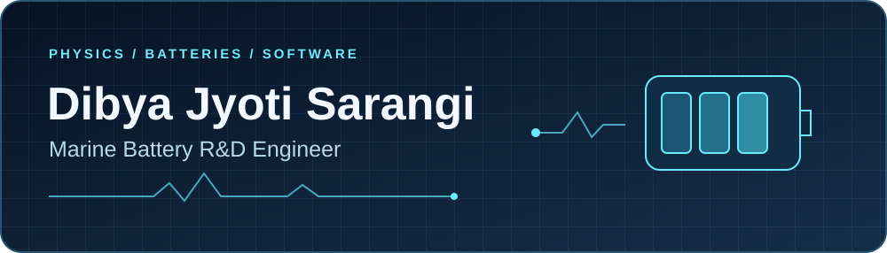

  

  <strong>I build diagnostic tools for marine lithium-ion batteries and software for the engineers who work on them.</strong>

  <a href="https://www.linkedin.com/in/dibya-jyoti-sarangi37"><strong>Connect on LinkedIn ↗</strong></a> ·
  <a href="https://dsarangi7.github.io/Fleet-Battery-Intelligence-Platform/">Fleet dashboard ↗</a> ·
  <a href="https://dibya-portfolio-jet.vercel.app/">Engineering portfolio ↗</a>

## From optical instruments to battery fleets

I started in physics and applied optics, earning the **Dr. Shankar Dayal Sharma Gold Medal at IIT Delhi**. At **ICFO Barcelona**, I worked on biomedical optical diagnostics as a **Marie Skłodowska-Curie FLIGHT Fellow**. That work taught me to ask how a signal was measured, what can distort it, and how to validate the inference. [Read the photonics paper](https://doi.org/10.1364/BOE.538141).

I brought those same questions to marine battery R&D. I started as an **R&D Engineer** and was promoted to **Senior Battery Analytics Engineer**. When a cell behaves differently, I want to know whether it’s a change in battery health or a result of load, temperature, or how the data was collected. I build tools that help engineers make that call from operational telemetry.

## Explore my work

| Project | What you can explore |
| --- | --- |
| **Fleet Battery Intelligence** | Explore degradation trends and condition-matched anomaly evidence in a fleet dashboard with synthetic data. [Try the demo](https://dsarangi7.github.io/Fleet-Battery-Intelligence-Platform/) · [Source](https://github.com/dsarangi7/Fleet-Battery-Intelligence-Platform) |
| **SOC Modelling** | Follow battery state-of-charge estimation from a one-RC circuit model to a two-RC model and an extended Kalman filter, with Python, MATLAB, and Simulink examples. [Source and learning path](https://github.com/dsarangi7/SOC-Modelling) |
| **Battery Calculators** | I built a free website that helps people estimate battery size and runtime for solar, home backup, RVs, and boats. The site also covers battery cell performance, DC voltage drop and cable losses, and commercial energy storage economics. The calculators run in your browser without an account and show their formulas and worked examples so you can check the results yourself. [Open Battery Calculators](https://batterycalculators.com/) |
| **Engineering Operating System** | I moved a 30-engineer R&D team from Excel to one BOM and ECN workspace that handled **about 1,000 governed approvals in 16 weeks**. The platform ties approved part revisions to ERP workflows so purchasing can use the correct part and revision. [Case study](https://dibya-portfolio-jet.vercel.app/projects/bom-engineering-workspace) |

### Tools I work with

`Python` · `MATLAB / Simulink` · `SQL` · `React / Next.js` · `TypeScript`

If you work on battery field data or state estimation, I’d like to hear what you’re trying to diagnose. [Connect on LinkedIn](https://www.linkedin.com/in/dibya-jyoti-sarangi37).
